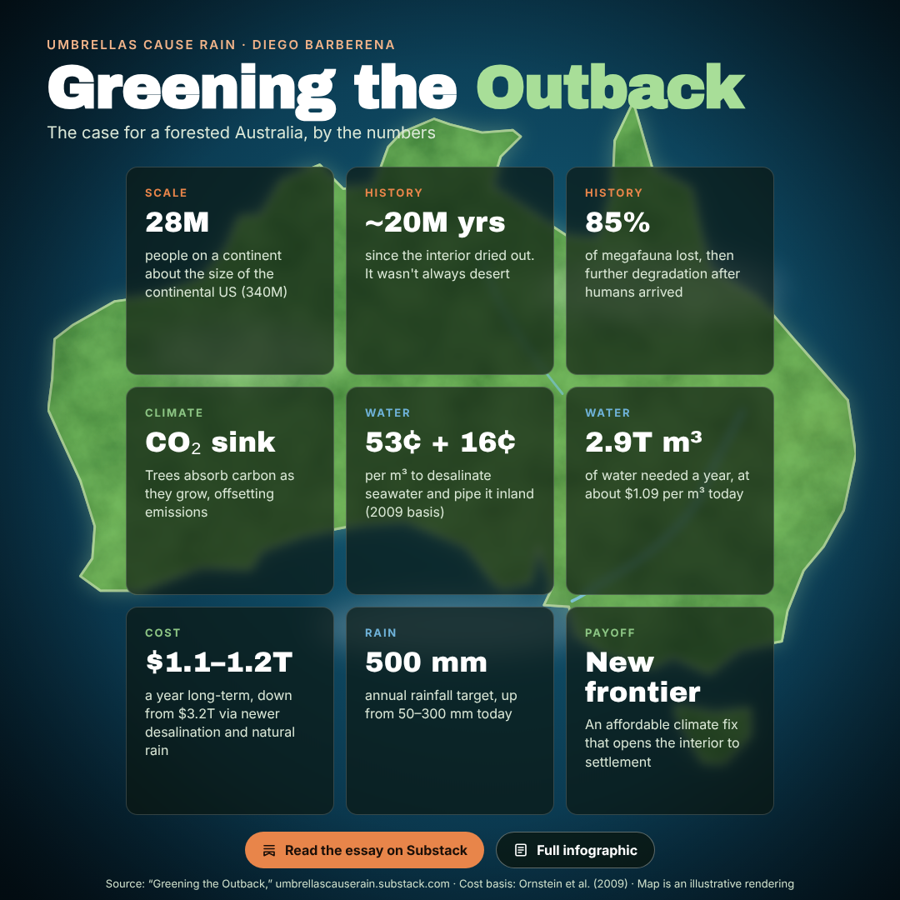

# Greening the Outback — Econ 238 Batsh!t Idea (Week 11)

**Diego Barberena · University of Rochester · Fall 2026**

What if we desalinated seawater on a continental scale and turned Australia's Outback into forest?

- **Infographic (one-click view):** [index.html](index.html)
- **Full infographic:** [poster.html](poster.html)
- **Full project / essay:** [Greening the Outback on Substack](https://umbrellascauserain.substack.com/p/greening-the-outback)

Cost figures follow the essay's back-of-the-envelope method, based on Ornstein et al. (2009). The map is an illustration, not a satellite image.
